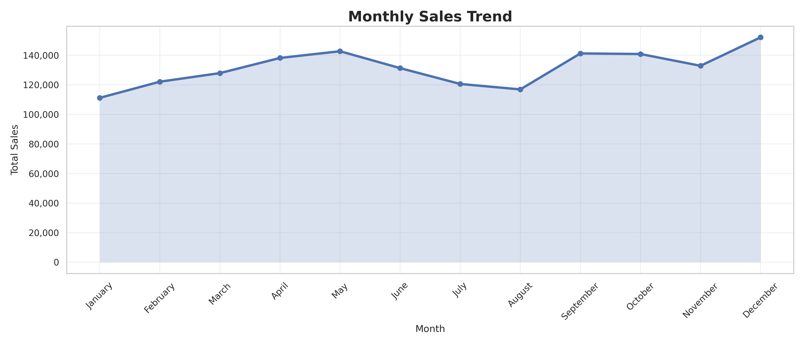
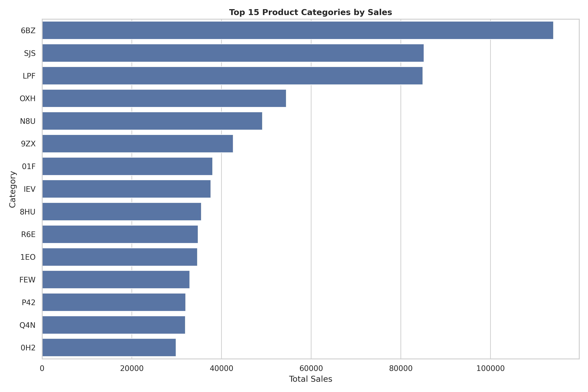
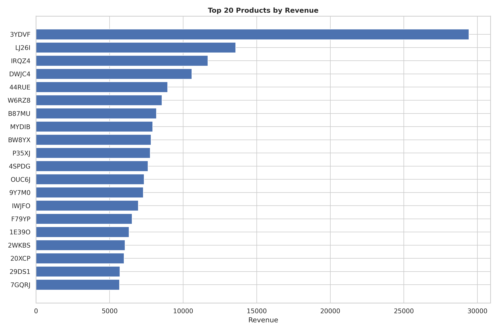
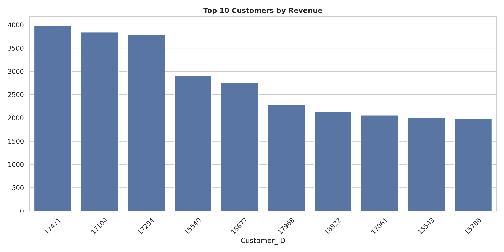

# Retail Sales Intelligence: Customer Segmentation and Sales Prediction Using Machine Learning

## Project Overview

This project is an end-to-end data science project that analyzes retail sales data using Python and machine learning.

The project focuses on understanding customer purchasing behavior, analyzing sales trends, segmenting customers, and predicting sales. It demonstrates the complete data science workflow from data cleaning to model building and evaluation.

This project was developed as part of my Data Science portfolio.

---

<table align="center">
<tr>
<td align="center">
 
<b>Monthly Sales Trend</b>
</td>

<td align="center">
 
<b>Top Categories</b>
</td>
</tr>

<tr>
<td align="center">
 
<b>Top Products</b>
</td>

<td align="center">
 
<b>Top Customers</b>
</td>
</tr>
</table>

# Business Problem

Retail businesses need to understand customer behavior and sales patterns to make better business decisions.

The main objectives of this project are to:

* Analyze retail sales data
* Identify customer purchasing patterns
* Segment customers into different groups
* Build machine learning models to predict sales
* Generate business insights from the data

---

# Dataset

Dataset: Retail Store Sales Transactions

The dataset contains more than 130,000 retail transactions with information such as:

* Date
* Customer ID
* Transaction ID
* Product Category
* Product (SKU)
* Quantity
* Sales Amount

---

# Tools and Libraries

* Python
* Pandas
* NumPy
* Matplotlib
* Seaborn
* Plotly
* Scikit-learn
* Google Colab
* KaggleHub

---

# Project Workflow

1. Data Loading
2. Data Understanding
3. Data Cleaning
4. Exploratory Data Analysis
5. Feature Engineering
6. Customer Segmentation using K-Means
7. Sales Prediction using Regression Models
8. Model Evaluation
9. Business Insights
10. Conclusion

---

# Machine Learning Models

## Model 1: Customer Segmentation

Algorithm:

* K-Means Clustering

Purpose:

Group customers based on their purchasing behavior.

---

## Model 2: Sales Prediction

Algorithms:

* Linear Regression
* Random Forest Regressor
* Gradient Boosting Regressor

Evaluation Metrics:

* Mean Absolute Error (MAE)
* Root Mean Squared Error (RMSE)
* R² Score

---

# Key Findings

* Customer purchasing behavior is different across customer groups.
* Some product categories generate higher sales than others.
* Customer segmentation helps identify different types of customers.
* Machine learning models can predict sales and support business decisions.
